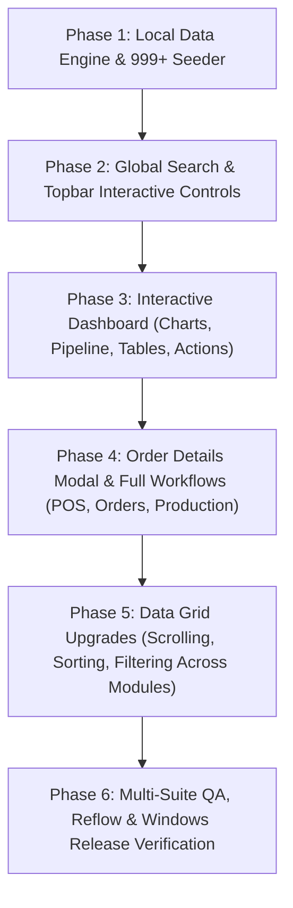

# LAUNDRYPRO UAE — MASTER INTERACTION, DATA ENGINEERING & ENTERPRISE ARCHITECTURE BLUEPRINT

## Executive Summary
This document establishes the comprehensive engineering roadmap to transform **LaundryPro UAE** from a visual prototype into a fully operational, responsive, standalone business operating system. Every visual container, chart point, table row, pipeline stage, dropdown, search field, and navigation path is upgraded into an interactive, database-driven control.

---

## 1. Interaction & Functional Audit Findings

| Module / Component | Observed Behavior | Required Operational Interaction | Status |
|---|---|---|---|
| **Global Search** (`_buildWorkspaceTopbar`) | Inert visual container with text & "Ctrl K" chip | Active search overlay dialog / popup querying customers, orders, inventory with instant result navigation and keyboard shortcuts | ⚠️ Defect |
| **Header Action ("Today" Pill)** (`dashboard_screen.dart`) | Static visual pill with calendar icon | Functional date range picker dropdown (Today, Yesterday, Last 7 Days, This Month, Custom Range) updating dashboard metrics dynamically | ⚠️ Defect |
| **Header Action ("+ New Order")** (`dashboard_screen.dart`) | InkWell without explicit route push | Direct navigation to `/pos` | ⚠️ Defect |
| **Metric KPI Cards** (`metric_card.dart`) | Non-clickable static metric presentation | Clickable drill-down navigation:  • Today's Revenue $\to$ `/reports` • Orders Today $\to$ `/pending` • In Production $\to$ `/production` • Ready for Pickup $\to$ `/pending?status=ready` | ⚠️ Defect |
| **Interactive Sparklines** (`metric_card.dart`) | Rendered static bezier curve | Hover tooltip showing historical datapoints and trend delta | ⚠️ Defect |
| **Revenue Overview Chart** (`dashboard_screen.dart`) | CustomPainter without gesture detector or mouse region | Dynamic mouse tracking with interactive glass tooltip showing Date, Revenue AED, Order Count, and Growth %, plus click drill-down to filtered Reports | ⚠️ Defect |
| **Chart Period Dropdown ("Last 7 days")** | Static pill container | Interactive popup menu (7 Days, 30 Days, Quarter, Year) triggering live calculation recalculation | ⚠️ Defect |
| **Order Pipeline Stages** (`dashboard_screen.dart`) | Horizontal segmented bar and rows without tap handlers | Clickable stages (`Received`, `Washing`, `Finishing`, `Ready`) navigating to `/production` or `/pending` filtered by that exact stage | ⚠️ Defect |
| **Recent Orders Table** (`dashboard_screen.dart`) | Table rows without selection, hover or click-through | Interactive data grid: hover highlight, clickable row opening full Order Details modal/sheet with customer info, line items, VAT, and thermal print action | ⚠️ Defect |
| **Quick Action Tiles** (`dashboard_screen.dart`) | Hover styling without destination routing | Functional workflows: • New Customer $\to$ Customer creation dialog • Record Payment $\to$ Payment modal • Stock Receive $\to$ Inventory adjustment dialog | ⚠️ Defect |
| **Data Tables across 16 Modules** (`app_data_table.dart`) | Standard table rendering | Enhanced with smooth mousewheel scrolling, horizontal scrollbars, column sorting, pagination controls, and row tap detail modals | ⚠️ Defect |
| **Offline / Local Data Engine** | Relies on remote REST endpoint `kApiBaseUrl` with fallback to empty lists | Local persistent SQLite / in-memory transactional database engine powering 100% offline standalone operation with realistic relational data | ⚠️ Defect |

---

## 2. Local Database & 999+ Demo Data Architecture

### 2.1 Standalone Database Strategy (`AppDatabase` / `LocalDataEngine`)
To guarantee reliable offline execution on Windows without an external backend server:
- Leverage `sqflite_common_ffi` (already configured in `pubspec.yaml`).
- Create a comprehensive relational schema covering:
  - `customers`: id, uuid, name, phone, email, trn, balance, loyalty_points, loyalty_tier.
  - `services`: id, name, category, price, unit, turnaround_hours.
  - `orders`: id, order_number, customer_id, customer_name, customer_phone, status, payment_status, subtotal, vat_amount, grand_total, balance_due, created_at, promised_date.
  - `order_items`: id, order_id, service_id, service_name, quantity, unit_price, total.
  - `payments`: id, order_id, amount, payment_method, reference, created_at.
  - `inventory_items`: id, name, sku, category, stock_quantity, reorder_level, unit_cost.
  - `employees`: id, name, role, department, salary, status.
  - `expenses`: id, category, amount, description, status, date.

### 2.2 Realistic Relational Seeding (999+ Records)
A deterministic demo seeder (`DemoDataSeeder`) will generate:
- **1,000+ realistic laundry orders** distributed across UAE locations (Dubai Marina, Downtown, Palm Jumeirah, Deira, Abu Dhabi).
- Relational integrity: every order links to a valid customer and 1–5 order line items (Wash & Fold, Dry Cleaning, Abaya Care, Suit Pressing, Curtain Cleaning).
- Multi-stage production states: `received`, `washing`, `finishing`, `ready`, `delivered`.
- Payment allocations: Cash, Credit Card, Apple Pay, Tabby, Unpaid, and Partial.
- Historical timestamps across the last 90 days to populate revenue trends, sparklines, and report aggregations.

---

## 3. Implementation Phases & Milestones

### Phase 1: Local Relational Data Engine & 999+ Seeding
1. Implement `LocalDataEngine` with tables for customers, catalog, orders, items, inventory, and staff.
2. Build `DemoDataSeeder` generating 1,000+ realistic connected records with valid UAE telephone numbers (`050...`, `055...`), AED currencies, and 5% UAE VAT.
3. Integrate with services (`SalesService`, `CustomerService`, `ReportsService`, `CatalogService`, `InventoryService`) to seamlessly read from the local database when offline.

### Phase 2: Global Search & Topbar Controls
1. Create `GlobalSearchDialog` (`Ctrl+K` / click on search box) featuring instant autocomplete, categorized results (Orders, Customers, Inventory), and direct drill-down.
2. Wire Branch and Terminal selector dropdowns.
3. Implement functional language switch with full RTL re-rendering.

### Phase 3: Interactive Dashboard Overhaul
1. **Interactive Revenue Chart (`_FuturisticRevenueChartPainter`)**: Add `MouseRegion` and `GestureDetector` to track cursor coordinates, display an interactive tooltip pill with exact AED revenue and order counts, and trigger drill-down on tap.
2. **Order Pipeline**: Make each bar segment and legend item clickable, navigating to `/production` or `/pending` filtered by stage.
3. **Metric Cards**: Add click handlers navigating to the relevant business screens.
4. **Header Date Range Filter**: Add a dropdown menu allowing selection between Today, Last 7 Days, This Month, and Custom Date Range.
5. **Quick Actions**: Wire up New Customer, Record Payment, and Stock Receive dialogs.

### Phase 4: Order Details Sheet & POS/Production Workflows
1. Build `OrderDetailDialog`: Displays order header, customer details, line items, payment status, stage progress, and receipt reprint.
2. Connect Recent Orders table rows to open `OrderDetailDialog`.
3. Verify POS order creation, cart calculations, 5% UAE VAT, and persistent order placement.

### Phase 5: Reusable Data Grid & Touch/Scroll Enhancements
1. Ensure all `AppDataTable` instances across operations, HR, and admin screens support mousewheel scrolling, horizontal trackpad panning, sorting, and responsive wrapping.
2. Guarantee zero `RenderFlex` overflows in both LTR and RTL across 1920x1080, 1366x768, and 1024x768.

### Phase 6: Automated Verification & Windows Build
1. Execute full test suite (`visual_runtime_reflow_audit_test.dart`, `all_screens_audit_test.dart`, `edge_case_test.dart`).
2. Build native Windows Release binary (`laundrypro_uae.exe`).
