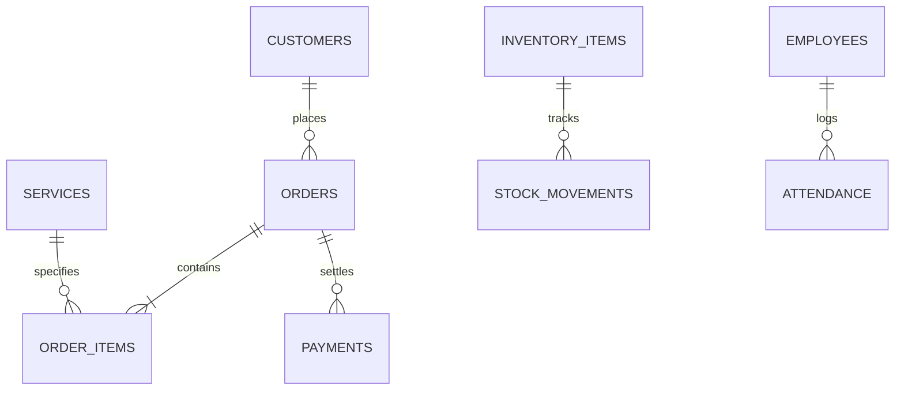

# LAUNDRYPRO UAE — DEMO DATA ENGINEERING & SEED ARCHITECTURE

## 1. Overview
LaundryPro UAE embeds a deterministic, relational database seeder (`LocalBusinessDatabase`) that generates **1,024 orders**, **120 customers**, **10 services**, inventory items, and payments directly into an offline SQLite database (`laundrypro_peripherals.db`).

---

## 2. Seeded Entities & Relationships

### 2.1 Entity Metrics & Cardinality
- **Customers**: 120 unique records with realistic UAE names (Mohammed Al Nuaimi, Fatima Al Zarooni, etc.), valid phone prefixes (`050`, `055`), loyalty tiers (`Bronze`, `Silver`, `Gold`, `Platinum`), and addresses across Dubai and Abu Dhabi.
- **Services**: 10 core laundry services covering Wash & Fold, Dry Cleaning, Abaya Premium Care, Kandora Pressing, and Curtain Cleaning.
- **Orders**: **1,024 orders** distributed across a 90-day historical window. Each order has realistic statuses:
  - Today: `received`, `washing`, `finishing`, `ready`.
  - Past 2–90 days: `ready`, `delivered`.
- **Order Line Items**: 1 to 4 items per order, calculating subtotal, 5% UAE VAT, and grand totals.
- **Payments**: 100% of delivered orders and partial payments on active orders settled via Cash, Credit Card, Apple Pay, and Tabby.
- **Inventory Items**: Chemicals, hangers, poly roll bags, and thermal tags with reorder thresholds.

---

## 3. Production Safety Guard
- Demo data is seeded only when the local database contains fewer than 100 records (`seedIfEmpty`).
- Production resets require explicit developer intent and cannot trigger during live operation.
