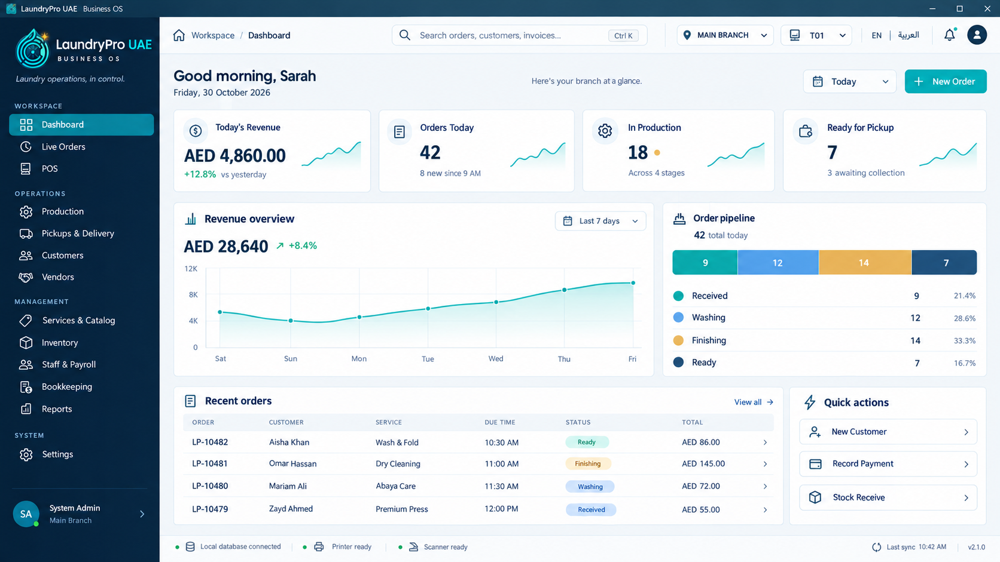

# LaundryPro UAE — Brand & Product Design System

**Document type:** Product UI/UX design specification and visual implementation guide  
**Product:** LaundryPro UAE Business OS  
**Product category:** Offline-first, standalone laundry operations platform  
**Primary deployment:** Windows desktop application / point-of-sale workstation  
**UI technology target:** Flutter Desktop, responsive Flutter layout system  
**Language support:** English (LTR) and Arabic (RTL), with an extensible multilingual label system  
**Currency baseline:** UAE Dirham (AED)  
**Document status:** Proposed production design baseline  
**Version:** 1.0  
**Date:** 30 October 2026  

> **Design intent:** Make LaundryPro feel like a premium, dependable business control centre—not an old-fashioned billing utility. The interface should help a laundry owner understand the branch, move orders through production, collect payments, manage inventory and staff, and resolve exceptions with minimal friction.

---

## 1. Executive design recommendation

### 1.1 Recommended brand

| Item | Recommendation |
|---|---|
| Primary product name | **LaundryPro UAE** |
| Interface/product descriptor | **Business OS** |
| Preferred wordmark rendering | `LaundryPro UAE` |
| Preferred short name | `LaundryPro` |
| Tagline | **Laundry operations, in control.** |
| Brand promise | One clear operating picture for every order, customer, rupee/dirham, item, employee and branch. |
| Personality | Confident, precise, calm, modern, practical and quietly premium. |
| Visual signature | Deep navy foundations, vivid aqua/teal action accents, a restrained gold highlight, and generous white workspace. |

**Keep the name LaundryPro UAE.** It is direct, easy to understand and suitable for a UAE-focused product. Avoid changing between “Laundry Pro”, “LaundryPro UAE”, “LaundryProUAE” and “laundrypro_uae” in customer-facing screens. Use `LaundryPro UAE` in the product wordmark and `laundrypro_uae` only where a machine-safe application identifier is required.

The proposed product lockup is:

**LaundryPro UAE**  
*BUSINESS OS*  
*Laundry operations, in control.*

Use the descriptor on the splash screen, sign-in screen, About page and brand collateral. It need not occupy dashboard space after the user has entered the application.

### 1.2 Positioning statement

LaundryPro UAE is a standalone, multilingual business operations platform for laundry and dry-cleaning businesses. It brings counter sales, POS, order processing, production, customer relationships, vendors, service and item catalogues, inventory, staff and payroll, bookkeeping, reporting and branch administration into one consistent operating experience.

### 1.3 Brand principles

1. **Operational clarity:** the next action and the true state of an order should be immediately obvious.
2. **Trust through consistency:** numbers, labels, statuses, dates, totals and navigation behave the same way across modules.
3. **Fast at the counter:** the most common POS actions require few clicks, clear keyboard focus and predictable shortcuts.
4. **Calm under pressure:** errors and warnings are visible without turning the whole workspace into an alarm screen.
5. **Offline confidence:** local data availability and peripheral readiness are explicit. Do not imply that internet access is mandatory for ordinary local operations.
6. **Localization by design:** Arabic is a first-class layout, not an English screen with translated labels pasted into it.

---

## 2. Logo and brand mark guidance

### 2.1 Supplied emblem assessment

The supplied icon uses a luminous aqua/turquoise droplet or leaf motif, circular water/washing rings, and a small gold sparkle on a deep navy rounded-square field. It communicates water, cleaning, care and a premium finish. It is a strong fit for the laundry category and is distinctive enough to retain.

**Recommendation: retain the core emblem. Do not replace it with a generic washing-machine, hanger or shirt icon.** Improve it as a controlled asset family rather than redrawing it differently on every screen.

### 2.2 Production refinements

Create or commission the following vector masters from the approved source artwork:

- **Primary emblem:** the droplet/ring/sparkle artwork with transparent background.
- **Primary horizontal lockup:** emblem at left, `LaundryPro UAE` wordmark at right, `BUSINESS OS` as a small descriptor below.
- **Compact lockup:** emblem plus `LaundryPro` for the sidebar when horizontal space is limited.
- **Monochrome light:** single-colour mark for dark surfaces and small print uses.
- **Monochrome dark:** single-colour mark for light backgrounds.
- **App icon:** centred emblem on a deep navy rounded square, without small wordmark text.
- **Favicon / tray icon:** simplified emblem with fewer internal details for tiny sizes.

The supplied 512 × 512 raster is suitable as a visual reference and provisional application icon. For production scaling, create a clean SVG/vector master and export the required PNG sizes from that master.

### 2.3 Logo rules

- Preserve the proportions, droplet outline, ring geometry and sparkle relationship.
- Never stretch, skew, crop, rotate, bevel or add a second glow to the logo.
- Never put the full dark rounded-square tile inside another dark tile unless the outer container is intentionally the application icon.
- Keep a clear-space margin of at least **0.25 × the emblem width** around the lockup.
- Recommended minimum emblem size: 24 px in a desktop sidebar; 16 px only for compact system surfaces after visual testing.
- Recommended lockup height: 38–44 px in the expanded sidebar; 28–32 px in a compact header.
- Use the gold sparkle as a logo detail only. Do not use gold as a competing primary interface colour.
- Do not place the luminous full-colour emblem on a highly saturated teal background; use navy or a neutral light surface.

### 2.4 Brand asset checklist

| Asset | Preferred format | Required variants |
|---|---|---|
| Master logo | SVG | Full-colour, white, dark monochrome |
| App icon | PNG + platform icon source | 16, 24, 32, 48, 64, 128, 256, 512 px |
| Sidebar lockup | SVG/PNG | Expanded and compact |
| Splash logo | SVG/PNG | Dark-background version |
| Receipt mark | SVG/monochrome | High-contrast one-colour |
| Report header mark | SVG/PNG | Light-background version |
| Tray/taskbar icon | PNG/ICO | Simplified small-size version |

---

## 3. Visual design direction

### 3.1 Chosen style: Premium Operations Console

The direction is a contemporary desktop business console with a restrained enterprise aesthetic:

- Deep navy navigation rail to anchor the brand.
- Bright, low-glare workspace for long operating sessions.
- Teal for primary actions, selection and meaningful progress.
- Blue for informational states and secondary navigation.
- Amber for attention and waiting states.
- Red only for errors, destructive actions and critical exceptions.
- Fine borders and restrained elevation instead of heavy shadows.
- Clear hierarchy, consistent spacing and high information density without visual clutter.

Avoid the old visual pattern of a narrow white icon strip, oversized blank header, scattered small cards and an unstructured list of menu items. The application should look like one deliberately designed system.

### 3.2 Visual qualities

| Attribute | Target |
|---|---|
| Overall feel | Premium, modern, calm and operational |
| Density | Medium; compact enough for POS work, never cramped |
| Surfaces | Flat white and soft cool-grey surfaces with subtle elevation |
| Corners | Consistent 10–16 px radii; avoid excessively pill-shaped panels |
| Borders | Thin, cool-neutral lines |
| Shadows | Soft, low-opacity shadows only for floating surfaces |
| Icons | One consistent outline icon family, consistent 1.7–2.0 px stroke |
| Motion | Purposeful, short and subtle; no decorative animation loops |
| Background decoration | Almost none; never compromise data readability |

---

## 4. Colour system

Use named semantic tokens in the theme layer. Do not scatter literal hex values through page widgets.

### 4.1 Core brand palette

| Token | Hex | Usage |
|---|---|---|
| `brand.midnight` | `#08243B` | Main sidebar, app titlebar, deep brand surfaces |
| `brand.navy` | `#10344F` | Sidebar hover, secondary dark surfaces |
| `brand.blue` | `#1D5278` | Selected dark-surface details and chart series |
| `brand.teal` | `#087F83` | Primary accessible action, selected states, important links |
| `brand.aqua` | `#20C6C5` | Logo-adjacent highlights, chart accents, decorative strokes |
| `brand.mint` | `#65DFC2` | Positive progress and subtle highlight accents |
| `brand.gold` | `#E9B34D` | Premium logo sparkle, limited highlight and waiting state |

### 4.2 Neutral palette

| Token | Hex | Usage |
|---|---|---|
| `surface.canvas` | `#F3F7FA` | Main application workspace background |
| `surface.primary` | `#FFFFFF` | Cards, tables, dialogs and forms |
| `surface.subtle` | `#F7FAFC` | Input backgrounds and secondary areas |
| `surface.selected` | `#E8F6F5` | Selected row or selected navigation state on light surfaces |
| `border.default` | `#DFE8EF` | Card, table and input borders |
| `border.strong` | `#C6D5E0` | Focus-adjacent or emphasized separators |
| `text.primary` | `#142D40` | Main headings and values |
| `text.secondary` | `#61778A` | Descriptions, labels and supporting text |
| `text.muted` | `#8294A3` | Timestamps and tertiary metadata |
| `text.inverse` | `#FFFFFF` | Text on dark surfaces and accessible filled buttons |

### 4.3 Semantic state palette

| State | Foreground | Soft background | Meaning |
|---|---|---|---|
| Success | `#167B61` | `#E6F5EF` | Paid, completed, ready, healthy |
| Information | `#286FA8` | `#EAF3FC` | Informational notices and neutral progress |
| Warning | `#9A650C` | `#FFF4D9` | Due soon, low stock, pending attention |
| Danger | `#B83D45` | `#FCEAEC` | Failed, overdue, blocked, destructive |
| Neutral | `#586B79` | `#EEF2F5` | Draft, inactive, not applicable |

**Accessibility rule:** coloured text must not be the only state cue. Pair the colour with a label and, where helpful, an icon. Use dark readable text on pale semantic fills. The teal primary button should use the darker `brand.teal` value with white text; reserve bright aqua for accents and chart lines. Verify all final text/background combinations against WCAG contrast targets during implementation.

### 4.4 Colour usage ratios

A practical starting ratio for the dashboard is approximately:

- 65–75% neutral workspace and white surfaces.
- 15–20% navy navigation and brand anchoring.
- 5–10% teal/aqua interaction and chart accents.
- Less than 5% semantic colours combined.

This keeps the product premium and avoids a screen dominated by decorative colour.

---

## 5. Typography and text system

### 5.1 Recommended font family

| Use | Font | Notes |
|---|---|---|
| English UI | **Inter** | Excellent functional UI legibility, numerals and forms |
| English display headings (optional) | **Manrope** | Use sparingly for page headings if a more distinctive tone is desired |
| Arabic UI | **Noto Sans Arabic** | Reliable Arabic glyph coverage and clear UI rendering |
| Arabic alternative | **IBM Plex Sans Arabic** | A more distinctive alternative if the full required glyph set is verified |

**Preferred first release:** use Inter for English and Noto Sans Arabic for Arabic. Keep one predictable family per active language rather than mixing several typefaces on the same screen. Bundle fonts locally in the Flutter application and confirm the font licences before distribution. The product must not rely on an internet font service at runtime.

### 5.2 Type scale

| Token | Size | Weight | Typical use |
|---|---:|---:|---|
| `display` | 30 px | 700 | Rare top-level welcome or sign-in title |
| `h1` | 26 px | 700 | Main page title |
| `h2` | 20 px | 650–700 | Major section title |
| `h3` | 16 px | 600–650 | Card title and subsection |
| `body` | 14 px | 400–500 | Default labels and content |
| `bodyStrong` | 14 px | 600 | Table emphasis and important labels |
| `small` | 12 px | 400–500 | Metadata and field hints |
| `micro` | 11 px | 500 | Compact uppercase group labels only |
| `metric` | 27–32 px | 700 | KPI values |

### 5.3 Typography rules

- Use sentence case for navigation, cards and buttons. Avoid all-uppercase menu labels.
- Use tabular numerals for currency, quantities, dates and report totals so columns align.
- Use 1.35–1.5 line-height for normal text and 1.1–1.2 for large metrics.
- Do not use light font weights for essential data.
- Avoid very small text below 12 px for frequently read operational information.
- Truncate long customer names only after a sensible width; preserve full values on detail view and tooltip.
- Use one consistent date/time and currency formatting policy across every module.

---

## 6. Application window and global shell

### 6.1 Desktop shell anatomy

The application should feel native to Windows while preserving a consistent custom visual system.

1. **Native or carefully integrated window titlebar:** app icon, `LaundryPro UAE`, window controls.
2. **Primary sidebar:** brand lockup, grouped navigation, active state and signed-in user block.
3. **Workspace topbar:** breadcrumb, global search, branch selector, terminal selector, language switch, notifications and user menu.
4. **Scrollable page canvas:** page title, context controls, dashboard/module content.
5. **Persistent status strip:** local database state, printer/scanner status, pending local operations or sync state when applicable, and application version.

Do not use two competing dark header bars. The recommended shell has a compact Windows titlebar, a clean light workspace topbar and a navy sidebar.

### 6.2 Reference desktop proportions

These are starting values for a 1648 × 918 reference composition, not hard minimums:

| Element | Reference size |
|---|---:|
| Windows titlebar | 28 px |
| Sidebar expanded width | 262 px |
| Sidebar compact width | 76 px |
| Workspace topbar | 60 px |
| Main content horizontal padding | 22–26 px |
| Main content vertical padding | 20–24 px |
| Bottom status strip | 34 px |
| Standard card radius | 12–14 px |
| Standard card internal padding | 16–20 px |
| Gap between major dashboard panels | 14–16 px |

Allow content to scroll independently from the sidebar and topbar. Do not let the bottom status strip cover the final row of content.

### 6.3 Sidebar structure

Use a full-height dark navy navigation panel, not a narrow white strip. Keep menu groups clearly separated and labels visible in expanded mode.

**Recommended navigation information architecture**

| Group | Navigation item | Purpose |
|---|---|---|
| Workspace | Dashboard | Branch-wide business overview |
| Workspace | Live Orders | Search and manage current orders |
| Workspace | POS | Fast counter billing and payment |
| Operations | Production | Washing, drying, finishing and QC workflow |
| Operations | Pickups & Delivery | Pickup, delivery and route tasks |
| Operations | Customers | Customer records, preferences and history |
| Operations | Vendors | Supplier records and transactions |
| Management | Services & Catalog | Services, garments/items, pricing and add-ons |
| Management | Inventory | Stock, consumption, purchases and adjustments |
| Management | Staff & Payroll | Employees, shifts, attendance and payroll |
| Management | Bookkeeping | Income, expenses, cash, ledgers and balances |
| Management | Reports | Sales, operations, inventory and financial reports |
| System | Branches & Terminals | Branch setup and workstation configuration |
| System | Users & Roles | Access control and permissions |
| System | Settings | Business profile, taxes, printer, language and preferences |

Show only modules licensed or enabled for the current deployment. Do not expose disabled modules as broken or inaccessible menu items. A future product may add a small “More” group, but do not overload the first screen.

### 6.4 Sidebar interaction

- Expanded by default on a wide desktop display.
- Compact mode retains icons and tooltips; it must never show clipped text.
- Active item uses a teal filled or teal-edged selection surface with clear text contrast.
- Hover uses a subtle navy lift; do not shift the row position.
- Use one consistent icon size, normally 19–21 px.
- Group headings are small, subdued and letter-spaced; navigation item labels remain normal case.
- The signed-in user block stays at the bottom and shows avatar/initials, user name, role and branch context.
- A click on the user block opens account/profile, lock screen and sign-out actions; do not sign out immediately.

---

## 7. Dashboard — production layout specification

### 7.1 Dashboard goal

The dashboard is an actionable branch overview, not a decorative report. It should answer these questions in seconds:

- How much has the branch sold today?
- How many orders are open, in production or ready for collection?
- Which work stage needs attention?
- What is the revenue trend over the selected period?
- Which recent orders require an action?
- Are the local database and counter peripherals ready?

The dashboard must not be a fixed set of fake zero-value cards. All KPIs, chart series, pipeline counts and recent-order rows must be driven by the selected branch, terminal permissions and date range.

### 7.2 Dashboard information hierarchy

**A. Page context row**

- Breadcrumb: `Workspace / Dashboard`.
- Greeting: `Good morning, [first name]` or a neutral `Branch overview` when a greeting is inappropriate.
- Current date displayed in the selected locale.
- Date-range control (`Today`, `Yesterday`, `This week`, `Last 7 days`, `This month`, `Custom`).
- Primary CTA: `New Order`.
- Keep the greeting line compact; it should not push KPIs below the fold on a standard laptop.

**B. KPI row — four primary cards**

| Card | Primary value | Supporting detail | Click action |
|---|---|---|---|
| Today's Revenue | AED amount | Change vs previous comparable period, if valid | Open sales filtered to date |
| Orders Today | Count | Newly received count or comparison | Open today's order list |
| In Production | Count | Active work across configured stages | Open production queue |
| Ready for Pickup | Count | Orders awaiting collection/delivery | Open ready queue |

KPI design:

- Use a compact icon badge, label, strong value and one supporting line.
- A small trend line is optional; omit it when no reliable trend data exists.
- Do not use red/green arrows without a meaningful comparator.
- Keep card heights consistent and values aligned.
- A skeleton should occupy the same shape while loading; do not flash a fake zero.
- If the branch has no activity, show a real zero and a helpful description such as `No orders recorded today`.

**C. Main analytics row**

Left panel: **Revenue overview**

- Total for selected range.
- Percentage comparison only when both comparison periods are valid.
- A line or area chart with clear dates and readable axis labels.
- Range selector within the panel only if it is not duplicating the page-level date range.
- Tooltips show date, currency and exact value.
- Avoid 3D charts, gradients that obscure data, and too many series.

Right panel: **Order pipeline**

- Display the actual configured workflow stages (for example Received, Washing, Finishing, Ready).
- Show counts and percentages based on a clearly defined denominator.
- Use a stacked horizontal bar only when it remains readable; show a labelled list underneath for accessibility.
- Do not hardcode four stages if the business has configured a different flow.
- Stage colours must remain consistent in Live Orders, Production, order details and dashboard.

**D. Lower workspace row**

Left panel: **Recent orders**

Recommended columns:

1. Order reference
2. Customer
3. Service / order summary
4. Due time
5. Current stage/status
6. Total amount
7. Row action / detail chevron

Use 4–6 rows in the initial viewport depending on screen height. Support row hover, keyboard focus, sorting where useful and a `View all` link. Do not rely only on colour for the status value.

Right panel: **Quick actions**

Recommended initial actions:

- New Customer
- Record Payment
- Stock Receive

The POS/New Order action is already a primary page CTA. Additional quick actions should be role-aware and configurable. Keep the quick-action panel to three or four rows; a long button catalogue defeats its purpose.

**E. Persistent status strip**

Show concise state labels with small status icons:

- Local database: Connected / Not available / Recovering.
- Printer: Ready / Offline / Not configured.
- Scanner: Ready / Offline / Not configured.
- Pending local operations or sync queue only if the product actually has such a mechanism.
- App version.

Never label the application “API Online” when the product is intended to operate locally without an API dependency. The status strip should tell the operator what is true in the local workstation.

### 7.3 Example dashboard values

The dashboard artwork uses illustrative figures, including AED 4,860 revenue, 42 orders, 18 in production and 7 ready for pickup. These are **visual sample values only**. Production must use actual database results and must never seed customer-facing business metrics from the design reference.

### 7.4 Error and loading states

The existing large red “Failed to load dashboard data” banner makes the entire application feel broken. Replace it with deliberate state treatment:

- **Loading:** show stable card/table skeletons and a small loading cue in the affected panel.
- **Partial failure:** show an inline alert inside the affected card/panel; preserve unaffected dashboard content.
- **Full data failure:** show a clean empty/error panel in the main workspace with a concise explanation, `Retry` action and diagnostic reference where appropriate.
- **No data:** show a true empty state with a relevant next action, not an error style.
- **Offline/local database unavailable:** show a high-priority but calm system alert and indicate which functions remain available, if known.

Error message pattern:

`We couldn't load [specific data]. Your other workspace data is still available.`  
Actions: `Retry` / `View details` where appropriate.

Do not display stack traces, SQL errors, filesystem paths or sensitive diagnostic data to ordinary users.

---

## 8. Component system

### 8.1 Buttons

| Type | Visual style | Use |
|---|---|---|
| Primary | Solid accessible teal, white text | Main action such as New Order, Save, Complete Payment |
| Secondary | White surface, border, dark text | Supporting action |
| Tertiary | Text/ghost button | Low-emphasis actions and table links |
| Destructive | Solid or outlined semantic danger | Delete, void, cancel with confirmation |
| Icon button | Consistent 36–40 px target | Refresh, notification, settings, close |

Rules:

- Standard height: 38–42 px; large POS action: 46–52 px.
- Use verb-first labels (`Save customer`, `Record payment`, `Print receipt`).
- Include hover, pressed, disabled, keyboard-focused and loading states.
- A loading button cannot be submitted repeatedly.
- Destructive buttons must not be the default focused action in a confirmation dialog.

### 8.2 Cards and panels

- White surface on the cool-grey canvas.
- 1 px neutral border; subtle elevation only when separation needs it.
- 12–14 px radius.
- Internal padding 16–20 px.
- Header aligns icon, title and optional contextual action.
- Panel content has a predictable empty, loading, error and populated state.
- Avoid putting a separate card inside every card; use dividers and spacing for hierarchy.

### 8.3 KPI cards

- Icon badge: 36–42 px, soft brand/semantic fill.
- Label: 13–14 px, medium weight.
- Value: 27–32 px, bold, tabular numerals.
- Supporting detail: 12–13 px, muted or semantic.
- Optional sparkline: compact and decorative, never the only trend indicator.
- Whole-card click behavior must be visually discoverable and keyboard accessible.

### 8.4 Tables

- Header fill: subtle neutral, not dark navy.
- Header text: 11–12 px, semibold; do not overuse all caps.
- Row height: 44–50 px for desktop operating tables.
- Row separators: thin neutral lines.
- Hover: pale teal/blue row fill.
- Selected row: clear left indicator or selected fill plus focus outline.
- Numeric columns right-align; references and names left-align in LTR.
- In RTL, mirror the layout while keeping numeric formats internally legible.
- Show pagination, result count and page-size controls only when needed.
- Use sticky headers for long lists and preserve visible table context when scrolling.

### 8.5 Status chips

Use a consistent small set of stage/status chips with text labels. A chip should be readable at a glance and not resemble a button unless it is interactive.

Example order state mapping:

| State | Suggested label | Treatment |
|---|---|---|
| Received | Received | Blue/info |
| Washing | Washing | Blue/teal |
| Finishing | Finishing | Amber |
| Quality check | Quality check | Violet/neutral, subject to palette approval |
| Ready | Ready | Green/success |
| Collected | Collected | Neutral/success |
| Delivered | Delivered | Success |
| On hold | On hold | Warning |
| Cancelled | Cancelled | Neutral or danger according to business policy |
| Overdue | Overdue | Danger |

The exact workflow is configurable; this table is a visual mapping proposal, not a claim that every laundry uses these stages.

### 8.6 Forms and data entry

- Persistent labels above fields; placeholders are examples, not labels.
- Required fields marked consistently and explained once.
- Field height: 40–44 px in standard forms; larger touch-friendly controls for POS.
- Validation appears adjacent to the field and is announced to assistive technology where supported.
- Preserve valid user-entered data after a recoverable validation or save failure.
- Use searchable selects for long customer, service, product and vendor lists.
- Do not put every form field into a single long modal. Use logical sections, drawers or a dedicated page for complex records.
- Make critical totals and payment balance visually prominent in POS and order completion flows.

### 8.7 Dialogs, drawers and notifications

- Dialogs for confirmations and short focused tasks.
- Right-side detail drawer for quick inspection of a selected order or customer when it improves the workflow.
- Full page for long/complex editing.
- Toasts for transient success or non-blocking feedback; never use a toast as the sole record of a critical failure.
- Confirm irreversible actions with a clear consequence statement and the record reference.

### 8.8 Icons

Adopt one coherent outlined icon family. Flutter implementation should use a bundled/local icon package or custom SVG assets approved for distribution. Do not mix filled, outline, emoji and platform-default icons arbitrarily. Maintain a standard 20 px navigation icon and 16 px inline icon, with accessible tooltip labels for icon-only controls.

---

## 9. POS and counter-workstation design

The POS is one of the highest-frequency workflows and requires a distinct operational layout while retaining the shared design system.

### 9.1 POS priorities

1. Find or create the customer quickly.
2. Add service/item lines without hunting through nested menus.
3. Capture garment/item quantity, weight or other configured unit correctly.
4. Apply configured pricing, discount, tax and add-on rules transparently.
5. Set promised date/time and notes.
6. Calculate total, paid amount and balance accurately.
7. Accept configured payment method(s).
8. Save the order and print/send the receipt using available peripherals.

### 9.2 POS visual hierarchy

- Customer and order header at the top.
- Service/item selection as the primary work area.
- Order line items with quantity/unit, rate and line total.
- Clear due date/time and special instructions.
- Persistent totals panel with subtotal, discount, tax, grand total, paid and balance.
- Primary `Save & Print` or configured completion action.
- Secondary `Save Draft` only where draft semantics are clear.

### 9.3 POS usability standards

- Keyboard-first operation with visible shortcuts.
- Logical Tab order; do not trap keyboard focus.
- Large click targets for touch-enabled terminals.
- Scanner input should be accepted without forcing a mouse interaction.
- Printer failure must not silently discard a saved order.
- Distinguish order saved from receipt printed. They are separate operation states.
- Prevent duplicate submission while a save/payment operation is running.
- Show a clear payment summary before final confirmation.

### 9.4 Suggested keyboard shortcut conventions

| Shortcut | Proposed action |
|---|---|
| `Ctrl + K` | Global search / command palette |
| `Ctrl + N` | New order, when permitted and not conflicting with OS conventions |
| `Ctrl + S` | Save current form where safe |
| `F2` | Focus customer search in POS |
| `F4` | Focus payment panel in POS |
| `Esc` | Close the topmost non-destructive overlay |
| `F1` | Open contextual help, if help content is implemented |

Shortcuts must be configurable or documented, must not conflict with text editing, and must be verified on the target Windows environment.

---

## 10. Responsive desktop and compact-screen behavior

Although the primary target is a Windows desktop POS application, the layout should adapt gracefully to resizing and smaller screens.

### 10.1 Breakpoint strategy

| Range | Layout behavior |
|---|---|
| 1440 px and above | Expanded sidebar; four KPI cards; two-column analytics; table and quick-actions side panel |
| 1200–1439 px | Expanded or compact sidebar based on available width; four KPIs if cards remain readable |
| 1024–1199 px | Compact sidebar; KPI cards may wrap to two rows; analytics remain two columns only if readable |
| 768–1023 px | Navigation drawer; two KPI columns; stacked analytics; table with horizontal scroll or responsive row treatment |
| Below 768 px | Compact/mobile navigation; single-column cards; POS-specific touch layout; avoid desktop tables that become unreadable |

The breakpoint values are implementation starting points. Validate with actual Windows window sizes, display scaling and Flutter text scaling.

### 10.2 Responsive rules

- Do not simply shrink all desktop elements. Reflow them.
- Sidebar becomes a drawer or overlay on narrow screens.
- Search becomes a compact icon or full-width field depending on width.
- KPI cards become two columns, then one column.
- Analytics panels stack in a meaningful priority order.
- Recent orders can use horizontally scrollable tables on tablet or labelled row cards on narrow mobile layouts.
- Keep POS payment total and main action visible while entering an order.
- Preserve generous tap/click target sizes at touch breakpoints.

---

## 11. Arabic, RTL and multilingual design

Arabic must be designed and tested as a full layout direction. It is not sufficient to translate English labels while retaining LTR positioning.

### 11.1 Direction rules

- English: LTR.
- Arabic: RTL.
- Mirror navigation placement, breadcrumb flow, drawer anchoring, leading/trailing icons and horizontal reading order.
- Do not mirror brand artwork, numerals, logos or icons whose meaning would change when flipped.
- Use logical start/end padding and alignment rather than hard-coded left/right values.
- Preserve familiar left-to-right presentation for technical IDs, serials, email addresses, barcodes and other inherently LTR data inside RTL screens.
- Use the correct Unicode bidirectional isolation for mixed Arabic/Latin values where required.

### 11.2 Arabic typography

- Use Noto Sans Arabic or a verified bundled alternative.
- Test connected glyph shaping, diacritics, punctuation, line-height and truncation.
- Give Arabic text enough vertical breathing room; do not reuse English line-height blindly.
- Avoid clipping the top/bottom of Arabic glyphs in buttons, chips and table rows.

### 11.3 Localization architecture guidance

- Keep UI labels, field hints, validation messages, empty states, tooltips and notifications in translation resources, not inline literals.
- Use stable translation keys such as `dashboard.today_revenue`, `orders.ready_for_pickup` and `pos.record_payment`.
- Store the selected language as a user/terminal preference according to the product's account model.
- Support fallback language when a translation key is missing; do not render a raw key to the operator.
- Format dates, times, currency, decimals and digit style through locale-aware formatting.
- Make digit style a configurable preference where the product requirements need it; do not silently mix Arabic-Indic and Western digits within a single operational value.
- Have a qualified Arabic reviewer validate business terms such as laundry stages, garment names, tax/payment wording and payroll terminology.

### 11.4 RTL QA checklist

- Sidebar appears on the correct side and active state remains clear.
- Breadcrumbs and page headers follow reading direction.
- Dialog buttons follow a deliberate RTL action order.
- Tables retain correct numeric alignment and readable IDs.
- Search fields, clear icons and dropdown indicators are correctly positioned.
- Charts keep chronological ordering and correct axis labels.
- POS totals remain readable and payment controls are not visually reversed incorrectly.
- Long Arabic labels wrap without overlapping icons or clipping.

---

## 12. UAE localization and business formatting

### 12.1 Currency

- Default currency: **AED**.
- Suggested English display: `AED 4,860.00`.
- Suggested Arabic display: locale-appropriate AED label/symbol placement, reviewed by the business owner.
- Keep the stored numeric value separate from the formatted display string.
- Use two fractional digits for ordinary AED presentation unless a specific configuration requires otherwise.
- Right-align monetary values in tables and totals panels.
- Use tabular numerals for all amounts.

### 12.2 Dates and time

- Use the system's configured timezone for branch-local business operations.
- Show unambiguous dates in reports and receipts; prefer a locale-aware format with month names where space allows.
- Use a consistent 12-hour or 24-hour format per terminal preference; never mix them on one screen.
- Due times, pickup times and transaction timestamps must be labelled clearly.
- Avoid ambiguous numeric dates such as `03/04/26` where day/month interpretation may differ.

### 12.3 Business labels

Use operationally precise labels: `Order`, `Customer`, `Service`, `Item`, `Quantity`, `Unit`, `Due by`, `Ready for pickup`, `Collected`, `Delivered`, `Paid`, `Balance due`, `Cash`, `Card`, `Refund`, `Void` and `Adjustment`. Avoid inconsistent synonyms for the same state across modules.

---

## 13. Data visualization and reporting design

### 13.1 Chart design

- Use line charts for trends over time, horizontal bars for stage comparisons and simple bars for category comparison.
- Use no more than 4–5 series in a single chart unless the report specifically requires more.
- Always label units and selected period.
- Show exact values in tooltips or accessible data summaries.
- Ensure chart colours are distinguishable in light and dark modes if dark mode is later introduced.
- Use a table alongside or as an alternative to charts for operationally important figures.
- Avoid pie/donut charts for many categories and avoid 3D effects.

### 13.2 Dashboard number integrity

- All totals must reconcile with the underlying business definition.
- The same date-range filter must apply consistently to KPIs, charts and lists unless a component is explicitly labelled as a live queue.
- Define whether a count is orders created today, active today, or orders due today; never call all three simply “Orders”.
- Define gross sales, net sales, discounts, tax, refunds and collected cash consistently in reports.
- Do not compare incomplete periods to completed periods without a clear label.
- Use `—` or a clear unavailable state when a percentage cannot be computed; do not show `0%` as a substitute for missing data.

---

## 14. Interaction, feedback and accessibility

### 14.1 Interaction feedback

Every actionable element must respond to:

- Default state
- Hover state
- Pressed state
- Keyboard-focused state
- Disabled state
- Loading state where applicable
- Success/failure result

Use short, consistent transitions (roughly 120–180 ms for simple hover/selection feedback). Avoid large animated transitions that delay POS work.

### 14.2 Accessibility requirements

- Maintain meaningful contrast for small text and icons.
- Never convey a state with colour alone.
- Provide keyboard access to all core workflows.
- Use visible focus outlines that are not removed for aesthetic reasons.
- Provide accessible names for icon-only buttons and controls.
- Support operating-system text scaling without clipping critical fields.
- Keep essential touch targets around 40–44 px or larger where possible.
- Respect reduced-motion settings where available.
- Do not rely on hover-only information.

### 14.3 Confirmation and destructive action patterns

For delete, void, refund, stock adjustment, payroll finalization and other high-impact actions:

- State the target record and the effect.
- Require an explicit confirmation appropriate to the risk.
- Show permission denial clearly when the user lacks authority.
- Record the action in an audit trail where required by the application rules.
- Do not hide critical consequences in tooltip text.

---

## 15. Local-first and standalone application experience

The visual design must reflect the real deployment model: a standalone desktop application that can perform its ordinary workflows against its configured local data store.

### 15.1 Status language

Prefer:

- `Local database connected`
- `Local database unavailable`
- `Printer ready` / `Printer offline`
- `Scanner ready` / `Scanner not detected`
- `Changes saved locally`
- `Pending sync` only if an actual sync feature exists

Avoid:

- `API Online` as the primary health state if normal use does not depend on an API.
- A cloud symbol suggesting all data is cloud-hosted when the deployment is local.
- A green status badge when the application has not verified the underlying dependency.

### 15.2 Failure boundaries

- Database connection failure should identify which operations are blocked.
- Printer failure should not be represented as order-save failure.
- A failed print should offer retry/reselect printer without creating a duplicate order.
- A saved order should remain distinguishable from an unsaved draft.
- If a local operation is queued for later processing, show the queue state and avoid implying completion until it is confirmed.

### 15.3 Privacy and operator awareness

- Mask sensitive information when the user role does not need to see it.
- Make branch and terminal context visible in the global shell.
- Show who is signed in and provide a clear lock/sign-out path.
- Do not expose customer phone numbers or financial details in unnecessary dashboard summaries.

---

## 16. Dark mode and theme strategy

**Release recommendation:** ship the light workspace + dark navy sidebar as the default theme. This gives a high-clarity working surface while retaining a strong brand frame.

A full dark theme can be added later only after all charts, tables, dialogs, status chips, inputs and peripheral states have semantic theme tokens. Do not implement dark mode as a simple inversion of the light palette.

Theme requirements:

- Theme values sourced from semantic tokens.
- Sidebar remains visually distinct but readable.
- Surface elevation and borders remain visible.
- Status semantics retain sufficient contrast.
- Charts use theme-aware series and grid lines.
- User preference is persisted locally where appropriate.

---

## 17. Screen design standards beyond the dashboard

The dashboard is the entry point, but every module must use the same shell and component library.

### 17.1 Live Orders

- Filter strip: order number, customer, branch, stage, date, due window and payment state.
- High-visibility queue counts without redundant KPI overload.
- Table with order reference, customer, due time, stage, amount and balance.
- Clear stage progression and quick detail access.
- Bulk actions only where safe and permission-controlled.

### 17.2 Production

- Configurable workflow stages displayed as tabs, columns or grouped queues.
- Each order card/row includes order reference, due time, service/item summary and priority.
- Highlight overdue and blocked orders with labels and explicit reasons.
- Make stage movement deliberate and auditable.
- Quality check and exception handling must not be hidden inside a generic status dropdown.

### 17.3 Customers

- Search by name, phone, customer code and supported identifiers.
- Customer profile summary: contact, preferences, active orders, recent history and account balance.
- Respect data permissions and mask contact details in roles that do not need them.

### 17.4 Services & Catalog

- Consistent hierarchy for service, item/garment, unit, rate, add-on and pricing rule.
- Make unit and conversion rules visible wherever they affect quantity or billing.
- Prevent duplicate or contradictory conversion concepts in the UI; define a single authoritative business rule for each conversion.
- Show effective dates and active/inactive states where pricing changes over time.

### 17.5 Inventory

- Overview of on-hand, low-stock, reorder and stock movement.
- Make unit of measure explicit on every quantity.
- Distinguish purchase, receipt, issue, consumption, transfer, adjustment and return.
- Require a reason for material manual adjustments.

### 17.6 Staff & Payroll

- Staff list, role, employment state, attendance/shift summary and payroll period.
- Payroll totals must be explainable with line-level details.
- Restrict salary and personal records by role.
- Clearly separate draft, calculated, approved and paid payroll states.

### 17.7 Bookkeeping

- Separate cash movement, sales, expenses, receivables, payables and account balances.
- Use readable ledger tables with clear debit/credit semantics where applicable.
- Do not use colour alone to indicate money in or out.
- Protect finalized entries from silent alteration; use controlled adjustment workflows.

### 17.8 Settings and administration

- Group settings by business, branch, terminal, users/roles, tax, language, printer/scanner and data maintenance.
- Distinguish global business settings from branch-level and terminal-level settings.
- Display the scope and impact of each setting before saving.

---

## 18. Flutter implementation guidance

This section translates the visual system into practical implementation rules. It is a design-system handoff, not a mandate to adopt a particular state-management or database package.

### 18.1 Theme architecture

- Define one central light `ThemeData` and a semantic colour/token class.
- Keep typography tokens, radii, spacing, elevations, icon sizes and breakpoints centrally defined.
- Use shared components for sidebar items, buttons, KPI cards, status chips, tables, empty states, dialogs and form fields.
- Use `Directionality` and locale-aware formatting at the application shell level.
- Use logical `EdgeInsetsDirectional`, `AlignmentDirectional` and start/end concepts for RTL safety.
- Avoid duplicating styles in each feature module.

### 18.2 Suggested design token structure

```text
lib/
  core/
    design_system/
      tokens/
        app_colors.dart
        app_spacing.dart
        app_radius.dart
        app_elevation.dart
        app_typography.dart
        app_breakpoints.dart
      theme/
        app_theme.dart
        app_theme_extensions.dart
      components/
        app_button.dart
        app_card.dart
        app_kpi_card.dart
        app_status_chip.dart
        app_text_field.dart
        app_data_table.dart
        app_empty_state.dart
        app_error_state.dart
        app_dialog.dart
        app_sidebar.dart
        app_status_bar.dart
```

The names above are a suggested organization. Adapt them to the existing project structure instead of creating duplicate token/component layers.

### 18.3 Layout composition

- Prefer `LayoutBuilder` and responsive composition over checking physical screen size throughout the widget tree.
- Use a reusable application shell with independently managed sidebar, topbar and page body.
- Use scroll views only where required; avoid nested competing scroll areas.
- Keep data tables within bounded widths and provide deliberate overflow behavior.
- Recompute grid columns from available content width, not simply from total monitor width.
- Support Windows display scaling and resizable windows.

### 18.4 Rendering and performance

- Keep dashboard cards independent so a failure in one data source does not blank the whole page.
- Avoid rebuilding the entire shell for every KPI update.
- Use lazy rendering for long lists and paginate/filter at the appropriate data layer.
- Cache stable reference data such as catalog labels and configured workflow stages where safe.
- Keep chart updates bounded and avoid expensive animations for large data sets.
- Load local images/icons efficiently and provide fixed dimensions to prevent layout shifts.
- Validate memory use and UI responsiveness on the minimum supported workstation specification.

### 18.5 Data presentation boundaries

- UI widgets receive typed view models, not raw SQL result maps scattered across the widget tree.
- Format money, quantities, date/time and percentages through shared formatters.
- Keep raw values separate from formatted display strings.
- Do not compute financial truth independently in several cards; reuse the same business calculation definition.
- Distinguish `null` (unknown/not loaded/not applicable) from `0` (known zero).

---

## 19. Quality assurance and acceptance criteria

The interface should not be considered production-ready merely because the dashboard screenshot looks correct. Verify the following on the actual target application.

### 19.1 Visual QA

- [ ] Brand mark is crisp and proportionally correct at all supported sizes.
- [ ] Sidebar width, alignment, group spacing and active state are consistent.
- [ ] Topbar controls do not overlap at supported desktop sizes.
- [ ] KPI cards share consistent height and value alignment.
- [ ] Tables remain readable with long names, large totals and long order references.
- [ ] No clipped labels, icon collisions, awkward line breaks or unintended horizontal scroll on the reference desktop.
- [ ] Error, empty, loading and populated states all have deliberate spacing.
- [ ] The bottom status strip does not cover content.

### 19.2 Functional QA

- [ ] Each navigation item opens the correct module and respects user permissions.
- [ ] Global search returns the correct entity types and opens the correct record.
- [ ] Date range changes update all components that should share the selected range.
- [ ] KPI clicks open the intended filtered list.
- [ ] `New Order` enters the correct POS/order flow.
- [ ] Recent order rows open the correct order.
- [ ] Quick actions open the correct create/transaction flow.
- [ ] Retry only retries the failed data operation and does not duplicate a transaction.
- [ ] Printer/scanner states reflect detected device state.
- [ ] Save success and print success are distinct and accurate.

### 19.3 Localization QA

- [ ] English layout is correct in LTR.
- [ ] Arabic layout is correctly mirrored and readable in RTL.
- [ ] Mixed Arabic and Latin identifiers do not reorder unexpectedly.
- [ ] Arabic glyphs do not clip in buttons, rows, badges or dialogs.
- [ ] AED/date/time formats are consistent.
- [ ] Long translated labels do not break navigation or cards.

### 19.4 Accessibility QA

- [ ] Keyboard can reach all core navigation and actions.
- [ ] Focus indicators are visible.
- [ ] Buttons and icons have meaningful labels.
- [ ] Status is communicated with text, not colour alone.
- [ ] Text remains legible at supported Windows scaling settings.
- [ ] Touch targets remain practical on supported touch terminals.

### 19.5 Data QA

- [ ] Dashboard totals reconcile with their source lists/reports.
- [ ] Date boundaries use the selected branch timezone.
- [ ] Revenue and payment definitions are documented.
- [ ] Zero and unavailable values are visually distinct.
- [ ] Sample values from the visual concept are not shipped as default business data.

---

## 20. Recommended delivery sequence

### Stage 1 — Design foundation

1. Approve product name, tagline, logo lockups and palette.
2. Create vector logo assets and local font assets.
3. Implement semantic tokens, typography, icon conventions and responsive breakpoints.
4. Build the global shell: titlebar integration, sidebar, workspace topbar and status strip.

### Stage 2 — Dashboard and reusable components

1. Build KPI cards, panels, charts, tables, status chips and quick actions.
2. Implement skeleton, empty, error and offline states.
3. Connect dashboard components to real branch-aware data definitions.
4. Verify keyboard, search and date-range behavior.

### Stage 3 — Core operating workflows

1. Live Orders and order detail.
2. POS and payment workflow.
3. Production queues and stage movement.
4. Customer and service/catalogue workflows.
5. Inventory, staff/payroll and bookkeeping screens using the same component library.

### Stage 4 — Localization and production QA

1. Arabic translations and full RTL pass.
2. AED/date/time formatting validation.
3. Windows resolution and display-scaling checks.
4. Printer/scanner state and failure testing.
5. Performance, accessibility and real-data reconciliation.

---

## 21. Design decisions to lock before implementation

The following decisions should be confirmed in the product requirements/configuration before UI implementation is treated as final:

| Decision | Recommended default | Owner decision required? |
|---|---|---|
| Product name | LaundryPro UAE | Yes, final brand approval |
| Tagline | Laundry operations, in control. | Optional approval |
| Default theme | Light workspace + dark navy sidebar | Yes |
| English font | Inter | Confirm font packaging/licence |
| Arabic font | Noto Sans Arabic | Confirm font packaging/licence and Arabic review |
| Default currency | AED, two decimal places | Confirm business configuration |
| Date/time format | Locale-aware; branch timezone | Confirm 12h/24h preference |
| Sidebar | Expanded desktop, compact/drawer responsive | Yes |
| Order stages | Configurable workflow stages | Define actual production workflow |
| Dashboard KPIs | Revenue, orders, in production, ready for pickup | Confirm business definitions |
| Sync indicator | Show only if an actual sync facility exists | Confirm deployment model |
| Dark theme | Later phase | Optional |

---

## 22. Final design direction

The recommended LaundryPro UAE identity is a **premium, calm, navy-and-teal business operating system** built around the supplied droplet emblem. The dashboard should be the command centre of the branch: one strong navigation structure, one consistent topbar, four meaningful KPIs, a readable revenue trend, a configurable production pipeline, recent orders, role-aware quick actions and a truthful local workstation status strip.

The most important improvement is not adding more decoration. It is creating a dependable visual hierarchy and a consistent component system so the entire application—from POS and production to inventory, payroll and bookkeeping—feels like one professional product.

**Brand lockup:** `LaundryPro UAE`  
**Descriptor:** `BUSINESS OS`  
**Tagline:** `Laundry operations, in control.`  
**Primary colours:** Midnight Navy `#08243B` + Accessible Teal `#087F83`  
**Supporting accents:** Aqua `#20C6C5`, Mint `#65DFC2`, restrained Gold `#E9B34D`  
**Typography:** Inter + Noto Sans Arabic  
**Interface direction:** Premium Operations Console  

---

## Appendix A — Visual concept

The accompanying `LaundryPro_UAE_Dashboard_Concept.png` is the proposed full-screen visual direction. It is a high-fidelity concept image, not a running application, and its displayed names, figures, orders and timestamps are illustrative. Treat this document as the design contract for implementation; validate every interaction and business rule against the approved product requirements.



## Appendix B — Handoff checklist

- [ ] Product name and tagline approved.
- [ ] Original emblem retained and vector master prepared.
- [ ] Horizontal, compact, monochrome and app-icon logo variants prepared.
- [ ] Brand and semantic colour tokens implemented centrally.
- [ ] English and Arabic font files bundled and verified.
- [ ] Shared application shell implemented.
- [ ] Responsive sidebar and navigation states implemented.
- [ ] Dashboard KPIs and charts bound to real data.
- [ ] Production pipeline stages are configuration-driven.
- [ ] Recent orders table supports real filtering and detail navigation.
- [ ] Quick actions are permission-aware.
- [ ] Local database, printer and scanner indicators report actual state.
- [ ] Loading, empty, partial-failure and full-failure states implemented.
- [ ] RTL layout verified on all core screens.
- [ ] POS keyboard and peripheral workflows tested.
- [ ] Windows display scaling and minimum window dimensions tested.
- [ ] Dashboard numbers reconcile with operational reports.

**End of document.**
