# LAUNDRYPRO UAE — NAVIGATION, DRILL-DOWN & WORKFLOW MAP

## 1. Application Shell Navigation Hierarchy

```mermaid
flowchart TD
    Shell["AppShell (/dashboard)"] --> Workspace["Workspace"]
    Shell --> Operations["Operations"]
    Shell --> Management["Management"]
    Shell --> System["System"]

    Workspace --> Dash["/dashboard (KPIs, Charts, Pipeline)"]
    Workspace --> Pending["/pending (Live Orders & Invoices)"]
    Workspace --> POS["/pos (Cart, Barcode, Thermal Print)"]

    Operations --> Prod["/production (Kanban & Machine Cycles)"]
    Operations --> Deliv["/delivery (Pickups & Van Routes)"]
    Operations --> Cust["/customers (Profiles & Loyalty)"]
    Operations --> Vend["/vendors (Suppliers & AP)"]

    Management --> Cat["/catalog (Services & Price Matrix)"]
    Management --> Inv["/inventory (Stock Balances & Movements)"]
    Management --> Staff["/hr/employees (Staff & WPS Payroll)"]
    Management --> Exp["/expenses (Bookkeeping & GL)"]
    Management --> Rep["/reports (VAT Return 201 & Analytics)"]

    System --> Set["/settings (Peripherals, Sync, Branch)"]
```

---

## 2. Dynamic Drill-Down Paths

### 2.1 Dashboard Drill-Down Matrix
- **Revenue Metric Card** $\to$ `/reports` (Sales summary, daily gross and net AED)
- **Orders Metric Card** $\to$ `/pending` (All active order items)
- **Production Metric Card** $\to$ `/production` (Kanban production board)
- **Ready for Pickup Card** $\to$ `/pending?status=ready` (Filtered ready collection items)
- **Revenue Chart Data Point Click** $\to$ `/reports` (Filtered to the selected day's transaction ledger)
- **Order Pipeline Segments** $\to$
  - `Received` $\to$ `/production`
  - `Washing` $\to$ `/production`
  - `Finishing` $\to$ `/production`
  - `Ready` $\to$ `/pending`
- **Recent Orders Row Tap** $\to$ `OrderDetailDialog` (Modal view showing customer contact, line items, 5% UAE VAT, and thermal reprint button)
- **Global Search Result Tap** $\to$ Directly routes to `/pending` (Orders), `/customers` (Profiles), or `/inventory` (Stock)

---

## 3. End-to-End Core Workflows

### 3.1 Customer-to-Order POS Workflow
1. Cashier opens `/pos`.
2. Searches or selects a customer (persisted in SQLite `customers`).
3. Taps services or scans barcode tags (`Wash & Fold`, `Abaya Care`).
4. Real-time calculations: subtotal, 5% UAE VAT, grand total in AED.
5. Selects payment method (Cash, Card, Apple Pay).
6. Taps "Confirm Order" $\to$ saves order in SQLite `orders` and triggers thermal receipt generation.

### 3.2 Production Kanban Workflow
1. Operator opens `/production`.
2. Orders appear categorized by stages (`Received`, `Washing`, `Finishing`, `Ready`).
3. Clicking stage status buttons updates order stage in SQLite and re-aggregates dashboard pipeline numbers.
