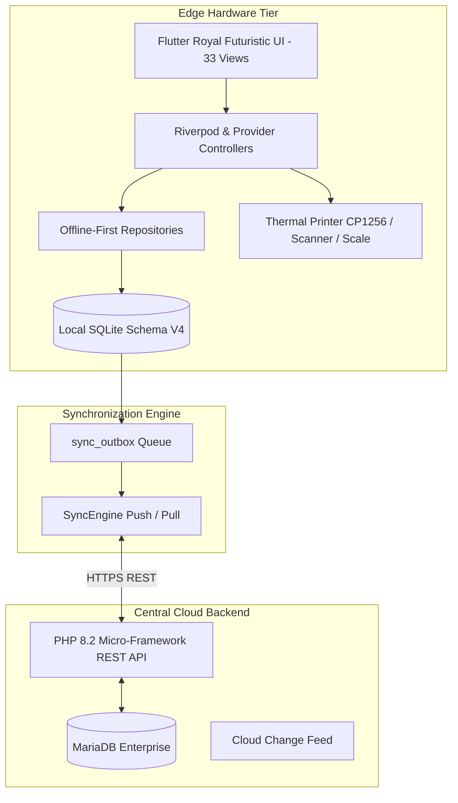

# System Architecture & Technical Topology
**Architecture Pattern:** Clean Architecture + Layered Offline-First Edge Repository Pattern

---

## 1. High-Level Architecture Topology

---

## 2. Layer Separation & Responsibilities

1. **Presentation Layer (`lib/views`, `lib/widgets`):**
   - 9-layer composited UI architecture.
   - Decoupled from direct database/network logic; consumes state through Providers.
   - Pure vector and Lottie asset rendering.
2. **State & Domain Layer (`lib/providers`, `lib/models`):**
   - Encapsulates UI state machines, permission checks (RBAC), and transactional calculations.
   - Immutable data models with explicit JSON mapping and null safety.
3. **Repository Layer (`lib/services`):**
   - Offline-first boundary: queries local SQLite database first, falling back to network REST endpoints.
4. **Peripherals & Native Hardware Tier (`lib/peripherals`):**
   - Isolates direct COM, USB, and ESC/POS byte streams behind clean abstraction interfaces.
