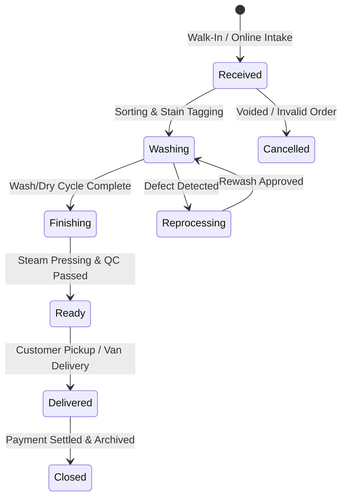

# End-to-End Business Workflows & State Transitions
**Version:** 3.0.0  
**Scope:** Order lifecycle, inventory replenishment, and accounting journal entries.

---

## 1. Unified Order Lifecycle State Machine

### Stage SLA & Turning Rules:
- **Received $\to$ Washing:** Max 2 hours for Express service; Max 12 hours for Standard.
- **Washing $\to$ Finishing:** Immediate transfer to minimize garment wrinkling.
- **Finishing $\to$ Ready:** 100% itemized count check against bundle tag.
- **Ready Notification:** Automated SMS/WhatsApp message sent immediately upon marking `Ready`.

---

## 2. Inventory Procurement & Reorder Workflow
1. Stock falls below `reorder_threshold`.
2. System flags item in `InventoryScreen` (`/inventory`) with an amber warning badge.
3. Purchasing officer creates Purchase Order in `PurchasingScreen` (`/purchasing`).
4. On delivery, warehouse logs Goods Received Note (GRN), verifying batch number and supplier invoice.
5. System auto-updates stock quantities, recalculates moving average unit cost, and creates accounting journal entry.

---

## 3. Financial End-of-Day Reconciliation Workflow
1. Cashier initiates drawer close from `AppShell`.
2. System tallies cash payments, card receipts, and account deductions against physical cash counted.
3. Over/short variance logged to immutable `audit_logs`.
4. Detailed Z-Report printed via thermal printer; daily transaction batch committed for synchronization.
